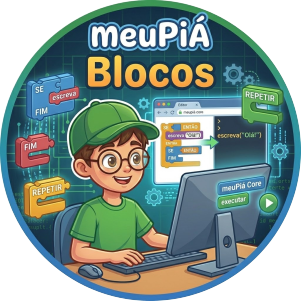

# 🧩 meuPiá Blocos



Editor de programação por blocos do ecossistema **meuPiá**. O estudante monta o
programa encaixando blocos, vê o Portugol correspondente nascer ao lado e o
executa pelo meuPiá Core, tudo no navegador. É o primeiro degrau da trilha
meuPiá, antes do Portugol escrito.

**Testes:** 1342 · **Cobertura:** 99,7%

## 💡 Por que o meuPiá Blocos?
Muitos iniciantes travam antes mesmo de escrever a primeira linha de Portugol.
O meuPiá Blocos é o degrau anterior: a lógica é construída com blocos visuais e
o código Portugol é mostrado em tempo real, para que a transição para o código
escrito aconteça naturalmente.

## ✨ Visão do produto
* 🧱 **Blocos:** área para montar o programa arrastando e encaixando blocos.
* 📝 **Portugol:** o código gerado a partir dos blocos, atualizado em tempo real.
* 🖥️ **Execução:** a saída do programa, executado pelo meuPiá Core.

## 🚀 Como rodar
Pré-requisito: [Node.js](https://nodejs.org) 20 ou mais novo (a versão do `package.json` e
do CI).

```bash
git clone https://github.com/KAUEsevla/blocos.git
cd blocos
npm install
npm run dev
```

Depois, abra http://localhost:5173 no navegador. Tudo roda na página, sem backend: na
primeira execução, o navegador baixa o Pyodide e o `meupia-core` (por isso precisa de
internet nesse momento).

Para gerar a versão de produção, estática, na pasta `dist/`:

```bash
npm run build
```

## 🧪 Como testar
```bash
npm test
```

Roda as duas suítes: **unidade** (geradores de Portugol, blocos, formato do projeto,
interface estática) e **aceitação**, que parte de projetos em blocos, gera o Portugol e o
executa no `meupia-core` 1.4.1 real, dentro do Pyodide no Node. Na primeira vez, a aceitação
baixa o `meupia-core` do PyPI.

```bash
npm run cobertura
```

Roda os testes com cobertura, grava o relatório em `cobertura/` e atualiza a linha de testes
e cobertura no topo deste README. O relatório pode ser aberto em
[cobertura/index.html](cobertura/index.html).

## 🛠️ Como foi desenvolvido
Com **Spec-Driven Development**, usando o [GitHub SpecKit](https://github.com/github/spec-kit)
e o [Claude Code](https://claude.com/claude-code). As regras do projeto estão na
[constituição](.specify/memory/constitution.md), e cada requisito do briefing virou uma spec
em `specs/`, com `spec.md` (o quê e o porquê), `plan.md` (o como) e `tasks.md` (as tarefas,
cada uma citando o requisito que atende). A [matriz de rastreabilidade](specs/README.md)
liga cada spec ao seu requisito.

## 🔗 Relação com o ecossistema
O meuPiá Blocos **consome** o ecossistema e não o modifica. O Core e os módulos
são usados apenas pelas interfaces públicas.

| Projeto | Papel |
| --- | --- |
| [meuPiá Core](https://github.com/meuPia/core) | Compila e executa o Portugol gerado |
| [meuPiá Lab](https://github.com/meuPia/lab) | IDE web onde o Portugol escrito continua a jornada |
| [meuPiá Maker](https://github.com/meuPia/maker) | Módulo para ESP32 e Pico |
| [meuPiá Desafios](https://github.com/meuPia/desafios) | Missões que o editor pode carregar |

## 📚 Referências
* [Scratch](https://scratch.mit.edu)
* [Snap!](https://snap.berkeley.edu)
* [Pencil Code](https://pencilcode.net)
* [Blockly](https://developers.google.com/blockly)
* [Microsoft MakeCode](https://makecode.microsoft.com)

## 🤝 Como contribuir
Leia o [CONTRIBUTING.md](CONTRIBUTING.md). Mudanças no compilador pertencem ao
[meuPiá Core](https://github.com/meuPia/core), não a este repositório.

## 📄 Licença
Distribuído sob a licença GPL-3.0. Veja [LICENSE](LICENSE).

## 🙌 Credits

Desenvolvido como parte do ecossistema educacional **meuPiá** por Kaue Marcelo Alves e Gabrielly Pensak.

* **Core Compiler:** [meuPia-core](https://github.com/meuPia/core)