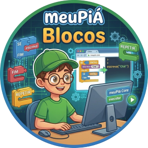

# 🧩 meuPiá Blocos

Editor de programação por blocos do ecossistema **meuPiá**. O estudante monta o
programa encaixando blocos, vê o Portugol correspondente nascer ao lado e o
executa pelo meuPiá Core, tudo no navegador. É o primeiro degrau da trilha
meuPiá, antes do Portugol escrito.

> 🚧 **Em construção.** Este repositório é a base para o desenvolvimento do
> editor com Spec-Driven Development. Ainda não há código.

**Testes:** 104 · **Cobertura:** 99,4%

## 💡 Por que o meuPiá Blocos?
Muitos iniciantes travam antes mesmo de escrever a primeira linha de Portugol.
O meuPiá Blocos é o degrau anterior: a lógica é construída com blocos visuais e
o código Portugol é mostrado em tempo real, para que a transição para o código
escrito aconteça naturalmente.

## ✨ Visão do produto
* 🧱 **Blocos:** área para montar o programa arrastando e encaixando blocos.
* 📝 **Portugol:** o código gerado a partir dos blocos, atualizado em tempo real.
* 🖥️ **Execução:** a saída do programa, executado pelo meuPiá Core.

## 🔗 Relação com o ecossistema
O meuPiá Blocos **consome** o ecossistema e não o modifica. O Core e os módulos
são usados apenas pelas interfaces públicas.

| Projeto | Papel |
| --- | --- |
| [meuPiá Core](https://github.com/meuPia/core) | Compila e executa o Portugol gerado |
| [meuPiá Lab](https://github.com/meuPia/lab) | IDE web onde o Portugol escrito continua a jornada |
| [meuPiá Maker](https://github.com/meuPia/maker) | Módulo para ESP32 e Pico |
| [meuPiá Desafios](https://github.com/meuPia/desafios) | Missões que o editor pode carregar |

## 📚 Referências
* [Scratch](https://scratch.mit.edu)
* [Snap!](https://snap.berkeley.edu)
* [Pencil Code](https://pencilcode.net)
* [Blockly](https://developers.google.com/blockly)
* [Microsoft MakeCode](https://makecode.microsoft.com)

## 🤝 Como contribuir
Leia o [CONTRIBUTING.md](CONTRIBUTING.md). Mudanças no compilador pertencem ao
[meuPiá Core](https://github.com/meuPia/core), não a este repositório.

## 📄 Licença
Distribuído sob a licença GPL-3.0. Veja [LICENSE](LICENSE).

## 🙌 Credits

Desenvolvido como parte do ecossistema educacional **meuPiá** por ___

* **Core Compiler:** [meuPia-core](https://github.com/meuPia/core)